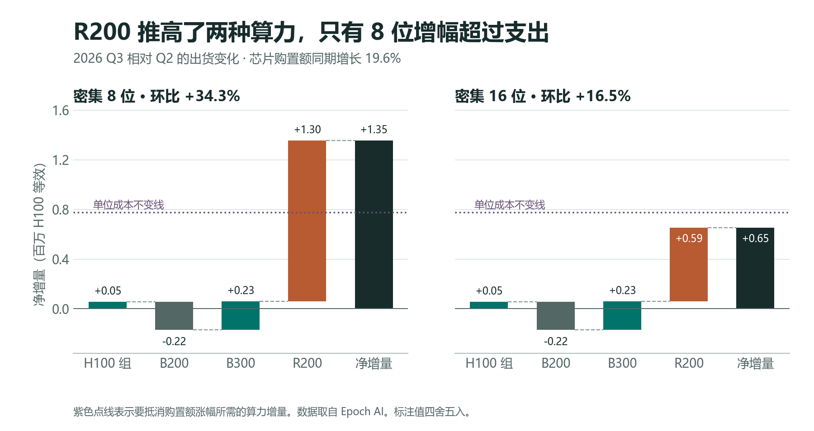
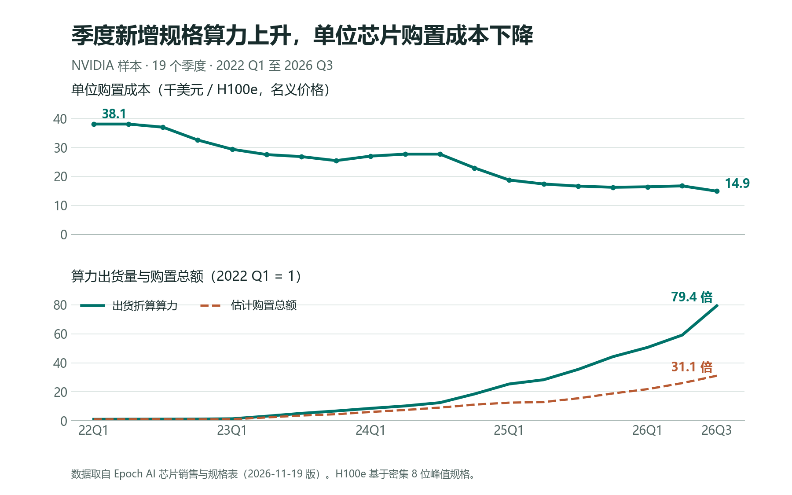

# 芯片换代之后，哪种算力真的变便宜了？

2026 年第三季度，NVIDIA 样本的芯片购置额比上季度多了 **19.6%**。同一季的出货折算算力，按 8 位算多了 **34.3%**，按 16 位算只多了 **16.5%**。所以，同一批出货，按 8 位计算的单位购置成本下降 **10.9%**，按 16 位计算却上升 **2.7%**。

这就是本节要解释的反差：**技术进步把哪一种算力变便宜了？** 它也是全组问题的起点。要看新增算力有多少真正投运，先得知道出货端增加的是哪些芯片、哪一种算力。[Epoch AI 芯片销售数据](https://epoch.ai/data/ai-chip-sales)

## 一笔采购账：多花的钱，买回了多少算力？

假设上一季的支出和算力都记作 **100**。这一季花了 **119.6**，至少也得买到 **119.6** 的算力，才能维持原来的单位成本。8 位算力涨到 **134.3**，过了这条线。16 位算力只到 **116.5**，没过线。这就是同一笔钱得到两种降本判断的原因。

怎样把不同型号加在一起？用 H100 作参照。一颗芯片在指定精度下的峰值速度是 H100 的两倍，就记作两个 H100 等效算力（H100e）。8 位和 16 位分别用 H100 的对应规格作基准。按型号把出货颗数乘以单颗等效算力，再加总。单位成本等于整季估计采购额除以整季等效算力。数据按官方链接型号匹配，使用 2022 Q1 至 2026 Q3 的 **55 条记录、19 个完整季度**，排除覆盖不全的 2026 Q4。[数据清洗与复算](数据处理记录.md)

## 为什么差这么多？看新出货的 R200

R200 比 B300 贵约 **74%**。它的 8 位峰值算力是 B300 的 **3.50 倍**，足以覆盖涨价。16 位峰值只有 **1.60 倍**，低于 **1.74 倍**的价格。这个型号一进入出货组合，两种精度的算力总量就被拉开。

图中的点线表示**需要新增多少算力，才能抵消 19.6% 的支出增幅**。R200 只占当季出货颗数的 **8.2%**，却贡献了 **95.6%** 的 8 位算力净增量。B300 的增量又大致抵消了 B200 的减少。这就解释了为什么同一季芯片颗数只增 **12.9%**，8 位折算算力却增了 **34.3%**。这里的 **95.6%** 衡量的是两季之间的净增量。[逐型号复算](results/effective_compute_q3_chip_growth.csv)

各代的估计单价、性能和功耗放在下面。一个容易忽略的例子是 B300 相比 B200 单价和功率都更高，而两者在这份数据中的 8 位峰值相同。因此，B300 在该规格口径下的单位成本更高。实际任务能否用到芯片的优势，还要结合模型所用精度和任务表现。[型号和价格原表](results/chip_specs_and_thresholds.csv) · [MLPerf 系统测试](https://github.com/mlcommons/inference_results_v6.1)

| 代表型号 | 每颗 8 位算力（H100e） | 估计单价（万美元） | 每颗额定功率（W） | 单位算力成本（万美元/H100e） |
|---|---:|---:|---:|---:|
| A100 | 0.32 | 1.20 | 400 | 3.81 |
| H100 | 1.00 | 2.50 | 700 | 2.50 |
| B200 | 2.53 | 3.70 | 1,200 | 1.46 |
| B300 | 2.53 | 4.30 | 1,400 | 1.70 |
| R200 | 8.84 | 7.50 | 2,300 | 0.85 |

## 拉长到 2022—2026 年，长期方向是什么？

从 2022 Q1 到 2026 Q3，季度出货颗数增至 **8.4 倍**，平均单颗 8 位规格算力增至 **9.5 倍**，两者相乘使出货折算算力增至 **79.4 倍**。估计总采购额增至 **31.1 倍**，所以每单位 8 位规格算力的成本从 **3.81 万降到 1.49 万美元**。按样本均价折算，同样预算可买到约 **2.55 倍**的 8 位规格算力。把起点换成 2024 Q1，单位成本仍降低 **44.8%**。长期确实降本，季度案例则说明了降本适用于什么口径。[长期趋势和起点检验](results/effective_compute_quarterly_windows.csv)

## 把出货账交到投运账

2026 年 11 月，NVIDIA 在同一份公告里披露 Vera Rubin NVL72 开始出货、部分合作方的机架已运行，另有合作方仍待上线。**芯片端的结论给出了出货端的起点：供给多了多少、哪一种算力更便宜。** 全组接下来要问的是，这些芯片在哪些项目、什么时候形成了投运容量，以及项目能为其提供多少电力。比较时应匹配批次、型号、地域、时点和精度；当季出货量与累计在运容量分别记录。[NVIDIA 出货与运行公告](https://nvidianews.nvidia.com/news/nvidia-announces-financial-results-for-third-quarter-fiscal-2027)

电力也有一笔同样的规模账。样本每单位 8 位规格算力对应的芯片额定功率下降 **62.2%**，当季出货对应的合计芯片额定功率仍从 **0.085 增至 2.55 GW**。这个口径供后续区分芯片额定值、实际投运设备和设施负荷。[季度功率复算](results/quarterly.csv)

[数据处理与复算](数据处理记录.md) · [课程评审](课程评审.md) · [补充采购案例](补充案例_固定租赁与按量补充.md)
