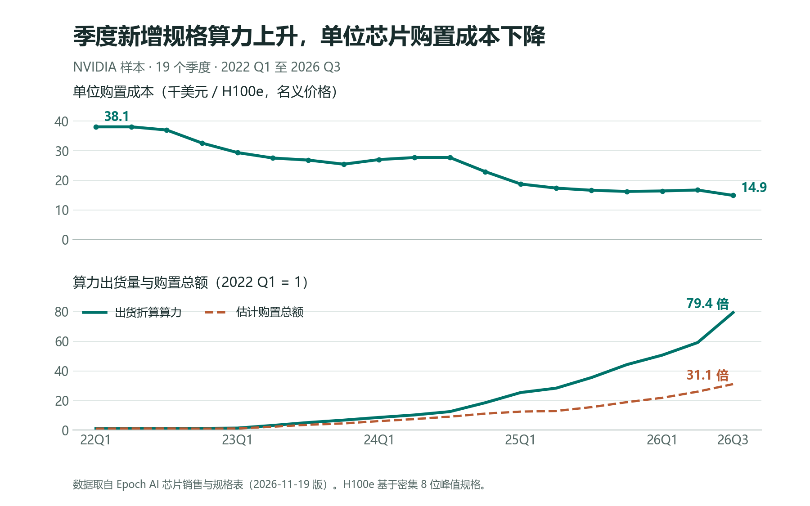
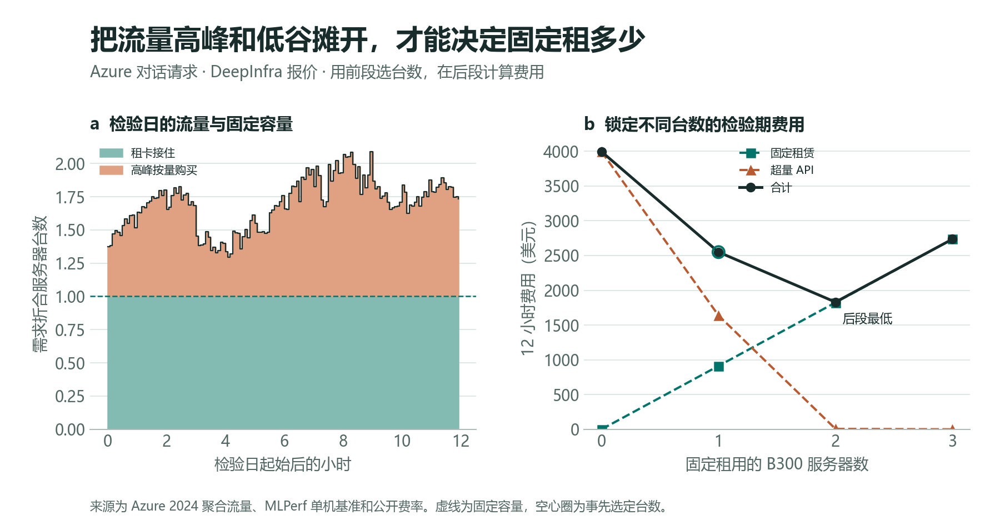
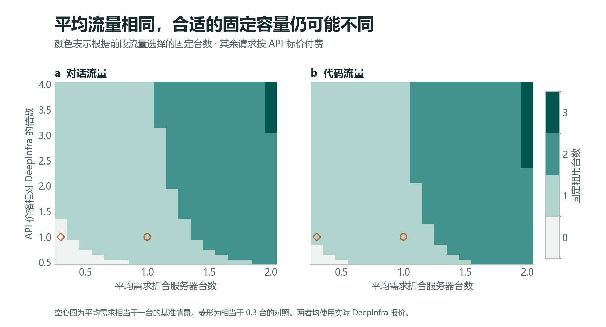

# 补充案例：固定租赁与按量补充

这份案例用于讨论取得算力后的采购策略。芯片供给与投运的中心论证见[分析材料](分析材料.md)。

2026 年第三季度，Anthropic 使用了约 **50 亿美元的短期算力**。它在上市招股书中说，这些算力的价格高于可比的多年合同。企业提前锁定容量，闲时也要付费。锁得少了，高峰又得临时补。本文把这个问题缩到一个可复算的决策：**给同一个模型配多少固定服务器，剩下多少按实际用量付费？** [Anthropic 最终招股书](https://www.sec.gov/Archives/edgar/data/2130357/000162828026074944/anthropicpbc-424b4.htm)

开放权重让同一模型可以自行部署，也可以交给不同服务商运行。黄仁勋复任前，NVIDIA 已公开支持开放权重并宣布拟收购 Hugging Face。Dario Amodei 同期倡议为前沿模型研发部署留出更多安全评估时间。双方还有投资和供货关系。对本项目而言，最可检验的商业变化是**同一个模型出现了多种取得算力的方式，可以对照公开报价与实际负载来比较**。已有 OpenRouter 实证研究也发现，模型供给、服务提供方和使用需求差异很大。本文固定开放权重模型 gpt-oss-120b，聚焦部署选择。[NVIDIA 复任公告](https://nvidianews.nvidia.com/news/nvidia-board-reinstates-jensen-huang-as-president-ceo-and-board-director) · [开放权重公开信](https://images.nvidia.com/pdf/Open-Weights-and-American-AI-Leadership.pdf) · [拟收购公告](https://blogs.nvidia.com/blog/nvidia-to-acquire-hugging-face/) · [Amodei 原文](https://darioamodei.com/post/we-must-pace-the-frontier) · [Anthropic 交割公告](https://www.anthropic.com/news/ipo-close) · [推理市场研究](https://www.aeaweb.org/articles?id=10.1257/jep.20261506)

## 1. 芯片降本了，整批采购却更贵

先把不同芯片的规格换成同一种单位。一单位相当于一颗 H100 在密集 8 位运算下的峰值速率。将 Epoch AI 的季度出货与规格表按链接型号匹配，去掉覆盖不全的记录，留下 **55 条 NVIDIA 记录、19 个季度**。每季分别加总估计购置额和折算算力，再相除。

**图 1。** 2022 Q1 到 2026 Q3，每单位规格算力的购置成本从 **3.81 万降到 1.49 万美元**，下降 **60.9%**。出货折算算力却增至 **79.4 倍**，相乘后，整批估计购置额仍增至 **31.1 倍**。截至 2026 Q2，单位购置成本较起点仍降 **56.1%**。单季结论更依赖口径。2026 Q3 按 8 位衡量环比降本 **10.9%**，按 16 位衡量则上涨 **2.7%**。因此，从规格降本推到业务节省之前，要先看企业能用到哪类性能。[Epoch AI 芯片销售数据](https://epoch.ai/data/ai-chip-sales) · [季度复算](results/quarterly.csv) · [换代分解](figures/02-cost-decomposition.svg)

## 2. 固定租一台，高峰交给按量服务

用 Azure 匿名请求记录保留**流量什么时候来、每次的输入和输出量**。对话记录使用 36 小时，前 24 小时选台数，后 12 小时检验。代码记录使用 8 小时，用作另一种负载对照。两种流量分别按选型期平均规模缩放到相当于一台服务器，流量起伏和输入输出比例来自记录。这里的 token 是模型处理的文字单位。[Azure 数据与出处](https://github.com/Azure/AzurePublicDataset/blob/master/AzureLLMInferenceDataset2024.md) · [DynamoLLM 原文](https://arxiv.org/abs/2408.00741)

模型逐个比较固定租 **0 台、1 台、2 台……** 的费用。每台每小时 **76 美元**，吞吐参照 MLPerf 的 Nebius 8 卡 B300 在线成绩。每五分钟，固定容量先处理能接住的请求，超出部分按托管服务的输入和输出标价计费。**多租一台，只有省掉的按量费用高于这台的租金，才划算。** 这是一项容量情景测算，吞吐取基准，未实测这批请求的排队和延迟。技术假设和完整费用公式见[数据处理记录](数据处理记录.md)。[MLPerf 实测](https://github.com/mlcommons/inference_results_v6.1) · [Nebius 报价](https://nebius.com/prices) · [DeepInfra 报价](https://deepinfra.com/openai/gpt-oss-120b)

**图 2。** 按 DeepInfra 标价，前 24 小时选出 **固定租 1 台**。到后 12 小时，平均需求升到选型期的 **1.70 倍**，约 **41.0%** 的输出量由按量服务承接。合计 **2,549 美元**，比全按量的 **3,994 美元**低 **36.2%**，也低于事后按最高流量备足 3 台的 **2,736 美元**。如果事先知道后半段会这么忙，两台的账单约 **1,830 美元**。这 **719 美元**的差距说明，便宜的设备只能帮一部分忙，**对持续需求上台阶的判断也值钱**。[费用复算](results/capacity_cost_curves.csv)

## 3. 单价和负载变了，最省的方案也会变

**图 3。** 横轴调平均需求，纵轴调按量服务的价格，颜色显示按前段流量应固定租几台。两类流量在 **648 个相同规模和价格设定**中有 **53 个**选择不同。比如平均需求相当于 **0.3 台**、使用实际 DeepInfra 标价时，对话流量在选型期选择全按量，代码流量选择固定租一台。保持代码流量不变，只按对话负载的输入输出比例计费，代码方案也改选全按量。**输入计费会改变选型，即使服务器能处理的工作量没有变化。** [决策网格](results/capacity_policy_grid.csv) · [计费对照](results/capacity_policy_evaluation.csv)

**别把一次省下的钱当成通用折扣。** 换用 Fireworks 标价，前段仍选 1 台，后段账单却达到 **7,355 美元**，高过按实际峰值备 3 台的 **2,736 美元**。在 DeepInfra 情景下把基准吞吐下调 **20%**，1 台加按量同样贵过峰值备机对照。把时间窗口换成 1 或 15 分钟，主情景仍选 1 台。可操作的判断是：**同时看正常流量、持续抬升的流量和溢出价格，分别给它们算账**。Azure 的历史形状、2026 年公开费率和基准吞吐组成的是回放情景。服务等级、未观测流量及真实调度会改变报价和容量要求。[Fireworks 报价](https://fireworks.ai/pricing) · [稳健性结果](results/capacity_policy_evaluation.csv)

**技术与复算。** [数据处理记录](数据处理记录.md)包含数据来源、筛选、公式和复算顺序。若课堂提问聚焦如何选芯片，可进一步看[成本与功率前沿](figures/05-procurement-pareto.svg)。按不同利用率比较同一模型的托管费率，见[部署门槛图](figures/06-open-weight-deployment.svg)。
