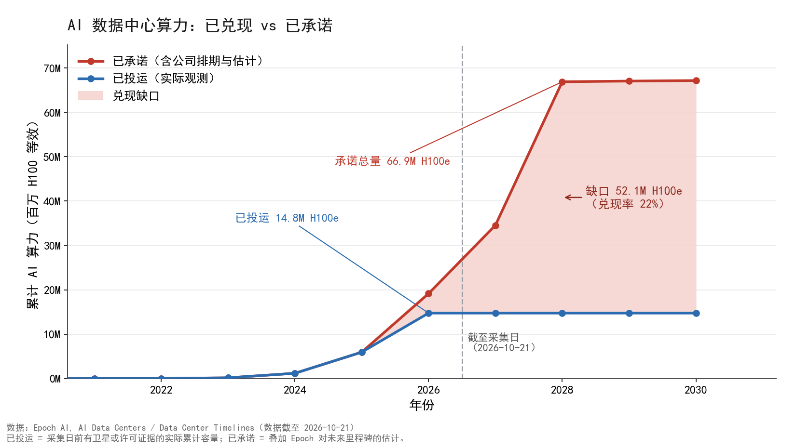
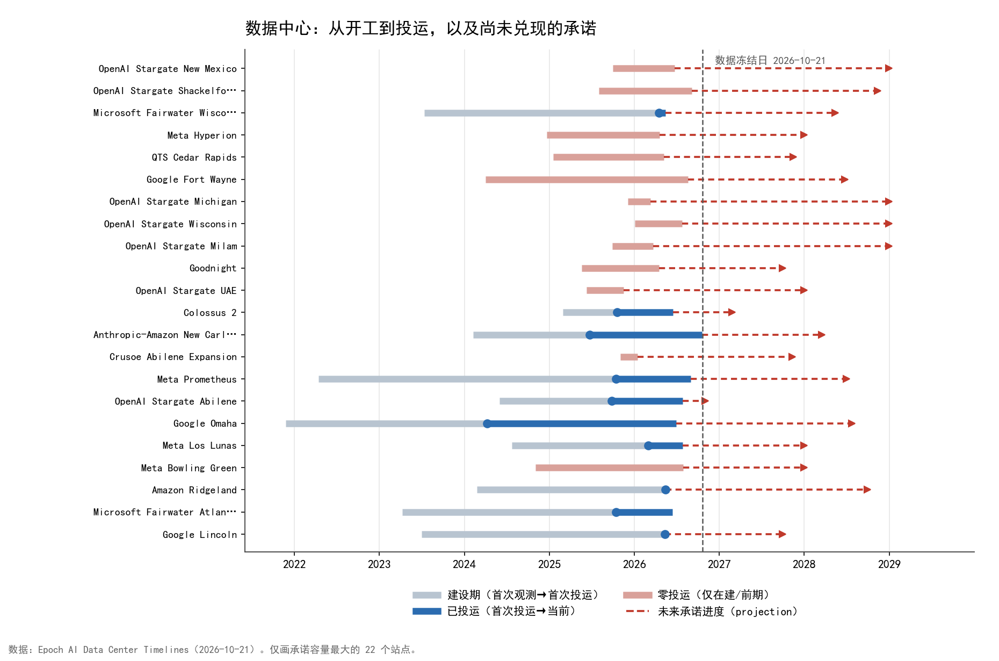
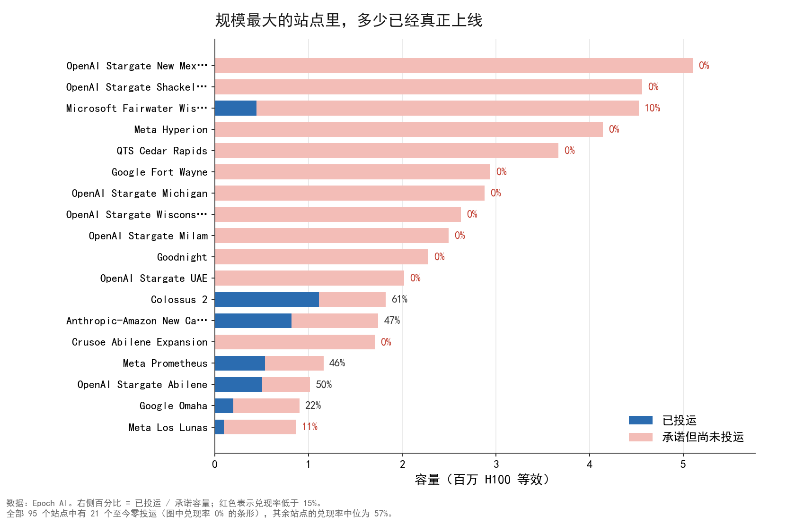
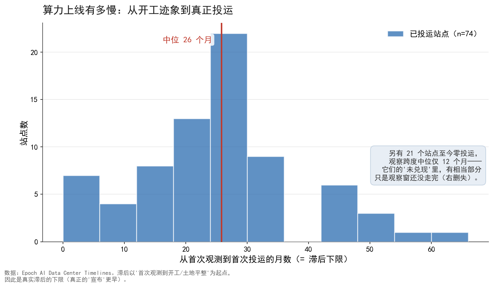
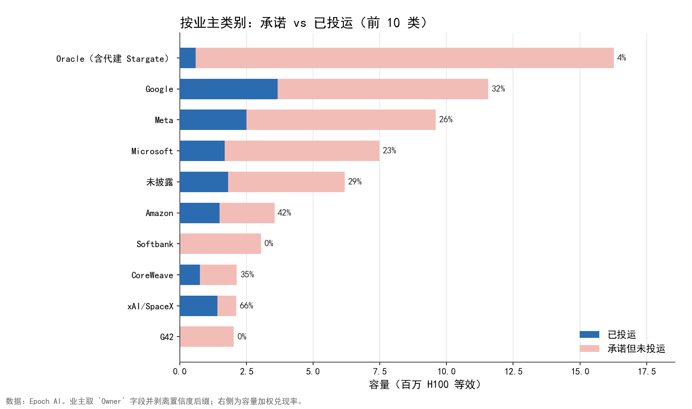

# 承诺的算力，兑现了多少？

2026 年 10 月的快照里，95 个最大的 AI 数据中心累计承诺了 **6715.6 万 H100 等效算力**，实际投运 **1475.2 万**，兑现率 **21.97%**。

但只看已经开工的 74 个站点，兑现率是 **50.85%**。同一份数据，两个答案差了 2.3 倍。

所以真正的问题不是"AI 建得慢不慢"——**而是缺口堆在哪儿**。这篇正文回答的就是这个：承诺去哪了、慢在哪、谁在承诺谁在交付。[数据来源](https://epoch.ai/data/ai-data-centers) · [处理记录](数据处理记录.md)

## 一笔账：承诺的 100 份算力，落地了 21.9 份

把承诺总量记作 100，按建设状态拆开：

| 去向 | 份数 | 站点数 |
|---|---:|---:|
| 已投运（达产） | 11.6 | 41 |
| 已投运（部分投运站点已上线部分） | 10.3 | 33 |
| **尚未投运：在建但只到土建** | **24.6** | **7** |
| **尚未投运：在建、已进入机电安装** | **29.4** | **12** |
| 尚未投运：已部分投运站点的后续分期 | 21.3 | 33 |
| 尚未投运：前期/土地平整 | 2.8 | 2 |
| 合计 | 100.0 | 95 |

**一半以上的承诺容量（54.0%），躺在 19 个从未上线的站点里——其中 12 个已经进入机电安装（29.4%），只有 7 个还停在土建（24.6%）。** 这两档的观察跨度差了 2.4 倍（15.8 个月 vs 6.7 个月），"在建"内部并不是同一类。

*图 1　累计已投运（蓝）与累计承诺（红），阴影为兑现缺口。虚线左侧为历史观测，右侧为承诺。*

这条曲线上还有第二个信号：**2024—2026 年实际新增 1457 万 H100e，而 2027—2030 年承诺新增 4800 万，是前者的 3.3 倍。** 也就是说，未来三年半要交付的量，是过去两年半的三倍多。[年度序列](../results/annual.csv)

## 读者必须先知道的三件事

否则后面的每个数字都会被误读。[完整处理记录](数据处理记录.md)

**第一，567 行里有 98 行的日期晚于冻结日 2026-10-21。** 观测不可能发生在未来，所以这 98 行是 Epoch 依许可、卫星影像和公开排期推算的**预测**，剩下 469 行才是实测。不切分的话，95 个站点会全部显示"已投运"，兑现率变成 100%。

**第二，每个容量数字都是累计值。** 时间线的每一行是"某一天该站的累计状态"，同一站 3–14 行。把同一站的 6 行相加会得到五倍于真实的数。

**第三，"承诺容量"原始数据里没有这个字段。** 它是用未来预测行构造出来的：站点全部行（含预测）中的最高累计规模。换一种定义，答案会变（见第六节）。

样本边界：95 个站点、12 个国家，其中美国 77 个、**中国只有 5 个**。所以本文任何说法都限定为"在本样本中"，不做国别推断。[站点级明细](../results/site_level.csv)

## 缺口不是摊开的：19 个站点吃掉一半以上承诺

按可复现的规则给 95 个站点定阶段：先用数值定粗档（是否已投运、是否达产），再按状态文本把"在建"分成土建与机电两档，并用 21 个零投运站点做了人工抽检校正。

| 阶段 | 站点数 | 承诺容量 | 占总量 | 观察跨度中位 |
|---|---:|---:|---:|---:|
| 已投运（达产） | 41 | 7.82 M | 11.6% | 35.3 月 |
| 部分投运 | 33 | 21.19 M | 31.6% | 32.0 月 |
| **在建（机电安装）** | **12** | **19.74 M** | **29.4%** | **15.8 月** |
| **在建（土建阶段）** | **7** | **16.53 M** | **24.6%** | **6.7 月** |
| 前期/土地平整 | 2 | 1.88 M | 2.8% | 7.8 月 |

*图 4　灰为建设期（首次观测到投运），蓝为已投运，粉为至今零投运，红虚线为冻结日后的承诺进度。*

图上有一个很直观的倒挂：**承诺越大的行越靠上，粉色和红虚线也越靠上**。Stargate 新墨西哥、Stargate Shackelford、Meta Hyperion 承诺都在 400 万 H100e 以上，至今一条蓝都没有，红虚线一直甩到 2028。能转蓝的都在下面：Colossus 2 从动土到上线只用了 7.7 个月。

*图 2　按承诺容量降序，右侧为站点兑现率，红色表示低于 15%。*

前 18 名里有 10 个兑现率为 0%。而已经跑起来的站点兑现率在 47%–61% 之间（Colossus 2 61%、Stargate Abilene 50%、Project Rainier 47%）。**同一张榜单上能同时看到 0% 和 61%**——说明"承诺"和"在建"是两套完全不同的状态。[阶段分类明细](../results/site_stage.csv) · [零投运站点原文](../results/state_audit.csv)

## 为什么慢：中位 26 个月，但有一半的"慢"只是没等到

从卫星图上第一次看到推土机，到算力真正上线：74 个已投运站点的**滞后中位 25.8 个月**，P90 为 44.0 个月，最长 64.8 个月。

*图 3　n = 74。起点是"首次观测到土地平整/施工"而非对外宣布，故该滞后是真实滞后的**下限**。*

这条数字的用处是定预期：**今天宣布的容量，按历史节奏大致要 2028—2029 年才可能变成可用算力。**

但这里必须主动修正一句：剩下 21 个零投运站点看着像失败，可它们的**观察跨度中位只有 11.9 个月**，21 个里有 11 个不到一年。时间还没到，不能判死刑——这是右删失。

这个判断还有个正面证据：19 个零投运站点里**已有 12 个进入机电安装**，观察跨度中位 15.8 个月——它们不是在"拖"，而是走到了最后一步。真正的早期项目只有 7 个（土建阶段，观察中位 6.7 个月）。

右删失也只能解释一部分：**Google Fort Wayne 已经被观察 28.6 个月，仍然是零投运**；Meta Hyperion（15.9 个月）、QTS Cedar Rapids（15.6 个月）同样为零。所以既有"时间不够"，也确实存在"承诺落空"的候选案例。

顺带一个自我提醒：按首次观测年份分 cohort，滞后中位从 2023 年 24 个月降到 2024 年 20 个月、2025 年 11.6 个月，看起来"越来越快"。**但这是选择偏差**——只有已投运的站点才进得了这张表，21 个零投运站点被系统性排除。要对齐观察窗才敢下结论。

## 谁在承诺，谁在交付

把 95 个站点按业主归类，图景比"大厂 vs 小厂"更尖锐。

| 业主 | 站点 | 承诺容量 | 兑现率 |
|---|---:|---:|---:|
| **Oracle（代建 Stargate）** | 6 | 16.28 M | **4%** |
| Google | 20 | 11.56 M | 32% |
| Meta | 17 | 9.60 M | 26% |
| Microsoft | 7 | 7.47 M | 23% |
| Amazon | 5 | 3.55 M | 42% |
| Softbank | 2 | 3.04 M | 0% |
| CoreWeave | 9 | 2.13 M | 35% |
| xAI / SpaceX | 3 | 2.11 M | **66%** |
| G42 | 1 | 2.02 M | 0% |

*图 5　前 10 类，右侧为容量加权兑现率。业主取自 `Owner` 字段并剥离置信度后缀；Stargate 各站记于 Oracle 名下。*

**一条业主吃掉近四分之一的承诺容量，兑现率却是全场最低（4%）。** 这里有个识别问题必须说明：Stargate 各站在 `Owner` 字段里记的是 **Oracle（代建方）**，不是 OpenAI。所以这条 4% 本质是**整个 Stargate 体系**的兑现率，不能读成"Oracle 自建数据中心交付差"。

反过来，兑现率最高的 xAI/SpaceX 只占承诺容量的 3%。

**一句话：承诺的人和交付的人，不是同一批人。** [业主分组表](../results/group_compare.csv)

## 换口径会不会翻盘

会翻，但方向不变。这是我认为最需要读者看的一节。

**口径敏感性**：兑现率在 7 种定义下从 11.68% 到 50.85%。

| 定义 | 兑现率 | 含义 |
|---|---:|---|
| A 基线（95 站，全行最高） | **21.97%** | 正文主口径 |
| B 仅有扩张承诺的 54 站 | 11.68% | 剔除 41 个构造性 100% |
| C planned 仅取预测行 | 11.68% | 与 B 等价 |
| G 只算已投运的 74 站 | **50.85%** | 剔除从未上线站点 |
| D 站点兑现率中位数（54 站） | 21.59% | 不含容量加权 |
| E / F IT 功率、总功率口径 | 37.18% / 36.49% | 见下 |

两个反直觉读数：**B（11.68%）比 A（21.97%）更低**——只算有承诺的站点，兑现率反而更差，因为最大的承诺恰好来自零投运项目；**C 与 B 完全相等**，说明最高规模永远出现在预测行，从不来自实测行。

**冻结日敏感性**：把观测/预测的切分点前后移动，兑现率从 19.47%（−60 天）到 26.57%（+60 天）。22% ± 4pp 内稳定，但**方向朝上漂**——越晚冻结越高，因为投运在持续发生。所以引用时必须写数据截止日。

**功率口径**：同一份数据，IT 功率管线倍数 **2.689×**、总功率 **2.741×**、算力 **4.552×**。差额可量化：实际投运算力密度 809 H100e/MW（总功率口径），承诺部分隐含 1344，高 66%。**4.55× 里有一部分是"未来用更密芯片"的技术假设，不是物理工程量。** 只报一个口径会被追问"你到底在说功率还是算力"。[七种口径](../results/definition_sensitivity.csv) · [冻结日扫描](../results/cutoff_sensitivity.csv) · [三口径对照](../results/caliber_comparison.csv)

## 把投运账交给下一位

芯片侧的账（出货多了多少、哪种算力更便宜）由李安然给出；能源侧的账（这些容量要多少电）由陈永翾接。

**我能交给下一位的**：95 个站点的首投运日期与投运时长、站点级算力与功率、建设状态分类，以及功率口径的统一说明（IT 功率 14.203 GW / 总功率 18.230 GW，比值中位 **1.299**，即 PUE 类开销）。

**这道账的交汇点**：本样本的承诺容量要把功率从 **18.230 GW 扩到 49.961 GW**，才谈得上"兑现"。

**我需要上一位给的**：分季度出货批次（型号、精度基准、折算算力）。有了它才能做"同一批芯片在何时何地形成投运容量"的匹配；没有它，出货账与投运账只能各自成立、无法闭合。这也是本部分在局限里最想标注的一条。

**本部分不做的**：芯片效率与单位成本、电力需求预测、能效分析、水耗。理由是这四项在分工中属于另两位，且所需数据不在本部分两张表内。

---

[数据处理记录](数据处理记录.md) · [全部结果表](../results/) · [全部脚本](../scripts/) · [总体说明](../README.md)
